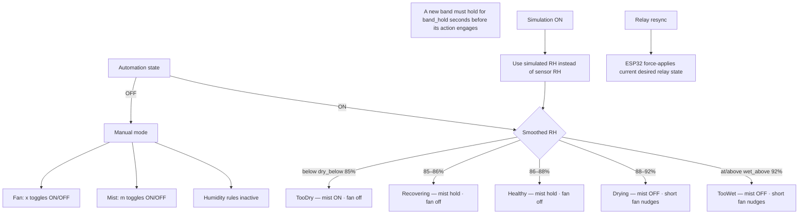

# monotub rules

This project controls a monotub with one humidity sensor, one fan relay, and one mist relay.

The control law is one linear model: classify the humidity into a **band**, then read
the mist and fan action straight off a single table. Airflow rises monotonically with
humidity; mist falls monotonically with it. There are no hidden timers or derived
thresholds — what you set is what runs.

## Quick Rule Chart



## Who Controls What

The ESP32 is the source of truth for the relays. The server and TUI only send commands
and display the latest ESP32 status.

**Automation ON (grow mode)** — one master switch for all logic:

- Mist and fan are both driven by the humidity band (table below).
- Manual `x` / `m` are disabled; use **Automation OFF** for service.

**Automation OFF (service mode)** — manual only:

- Fan: `x` toggles the relay.
- Mist: `m` toggles the relay.
- Humidity rules are inactive.

## The Band Table

This single table is the whole control law.

| Band       | RH range            | Mist | Fan         |
| ---------- | ------------------- | ---- | ----------- |
| TooDry     | below `dry_below`   | ON   | off         |
| Recovering | `dry_below`–`band_low`  | hold | off     |
| Healthy    | `band_low`–`band_high`  | hold | off     |
| Drying     | `band_high`–`wet_above` | OFF  | nudge   |
| TooWet     | at/above `wet_above`    | OFF  | nudge   |

Default band edges:

- `dry_below`: `85%`
- `band_low`: `86%`
- `band_high`: `88%`
- `wet_above`: `92%`

The four edges are explicit and independent — moving one does not shift the others.
They must stay ordered (`dry_below ≤ band_low ≤ band_high ≤ wet_above`); an out-of-order
change is rejected.

## Band Hold (the one debounce)

A newly entered band must hold continuously for `band_hold` seconds (default `10s`)
before its action engages. Until then the previous band's action stays in effect. This
is the only timing guard in the system — it replaces all the old persist timers,
cooldowns, and pulse caps. A brief humidity spike that clears before `band_hold` never
changes anything.

While a transition is pending, the TUI shows `settling Ns`.

## Mist Rules

Mist follows the table's mist column, which is deliberate hysteresis:

- Below `dry_below` (`85%`): mist ON.
- Above `band_high` (`88%`): mist OFF.
- In between (`85–88%`): mist holds its previous state.

That hold zone prevents the mist relay from flickering around one exact number. When
automation is OFF, `m` toggles mist manually and humidity does not control it.

## Fan Rules

The fan is a conservative wetness correction, not continuous FAE. Polyfill provides the
baseline air exchange; the fan only gives short nudges when humidity is above the healthy
band.

- **Off** (`TooDry`, `Recovering`, and `Healthy`, below `88%`): fan idle.
- **Nudge** (`Drying` and `TooWet`, at/above `88%`): short timed fan cycle.
  Default `5s` ON / `90s` OFF.

Once nudging starts, the ON phase stops by timer, not by waiting for RH to fall. The cycle
fully stops only after RH returns below `band_high` and that band passes `band_hold`.

## Automation OFF Rules

When automation is OFF:

- Humidity rules do not control fan or mist.
- Fan is manual with the `x` key.
- Mist is manual with the `m` key.
- Band edges and nudge settings are informational only.

## Simulation Rules

Simulation mode lets you test the rules without changing the real chamber humidity.

In the TUI Sensor section:

- `s` toggles simulation ON/OFF.
- `+` increases simulated humidity.
- `-` decreases simulated humidity.

When simulation is ON:

- The ESP32 uses the simulated humidity instead of the SHT31 humidity.
- The TUI shows `SIM`.
- Automation reacts exactly as if the real sensor had that humidity.

When simulation is OFF, the ESP32 goes back to using the real SHT31 sensor.

## Relay Sync Rules

On ESP32 boot:

- Relays are held OFF for `5s`.
- After the boot delay, the ESP32 force-applies the desired fan and mist relay states.

In the TUI Device section, `y` forces a relay resync — making the physical relay outputs
match the ESP32's current software state.

## TUI Key Rules

Fan section:

- `x` toggles manual fan only when automation is OFF.
No fan timing edits are exposed in the TUI; nudge timing is configured over MQTT / the
server API.

Mist section:

- `m` toggles manual mist only when automation is OFF.

Sensor section:

- `s` toggles simulation.
- `+` increases simulated humidity.
- `-` decreases simulated humidity.

Automation section:

- `a` toggles automation ON/OFF.

Device section:

- `y` resyncs relays.

Global:

- `Tab` changes section.
- `l` shows logs.
- `?` shows help.
- `q` quits.

## Flashing the ESP32

Copy `esp32/include/secrets.h.example` to `esp32/include/secrets.h` and fill in Wi-Fi. MQTT defaults to `homeserver.local`: name the broker's machine `homeserver` and the board finds it by mDNS whatever its IP. To point a running board elsewhere, send `mqtt host[:port]` over USB serial (115200 baud); it is saved on the board.
Leave `OTA_PASSWORD` as it is: the first build replaces it with a random password and prints it
once. Save it if you will flash from another computer. To get a new one, delete the
`OTA_PASSWORD` line and flash over USB again.

The first flash goes over USB:

```sh
cd esp32 && pio run -e esp32dev -t upload
```

After that, flash over Wi-Fi. The board answers as `monotub.local` (or use its IP). The password
is read from `secrets.h`; set `MONOTUB_OTA_PASSWORD` only to override it:

```sh
cd esp32 && MONOTUB_OTA_HOST=monotub.local pio run -e esp32dev-ota -t upload
```

The board connects back to the flashing computer on TCP port 3233, so a host firewall must allow
it from the LAN, for example `sudo ufw allow from 192.168.86.0/24 to any port 3233 proto tcp`.

Both relays switch off when the update starts and stay off through the reboot and the boot delay;
a failed update hands them back to the controller.

## Moving the box

The board remembers the last Wi-Fi it joined. A fresh board starts with `WIFI_SSID` from
`secrets.h`; after that the saved network wins, so changing `secrets.h` and reflashing does not
move a configured board. When that network is not reachable at boot, it opens a setup hotspot for 3 minutes:

1. On your phone, join the Wi-Fi `monotub-setup`. Its password is the `OTA_PASSWORD` from
   `secrets.h`.
2. The setup page opens by itself (otherwise browse to `http://192.168.4.1`). Pick your network
   and type its password.
3. The board joins it and keeps it. Unplug it and plug it back in to get the hotspot again if you
   missed the 3 minutes.

Humidity control keeps running while the hotspot is open. The broker must still be reachable as
`homeserver.local` on the new network (see the `mqtt` serial command above to point it elsewhere).

## Running the server

Locally, from source, with a throwaway broker:

```sh
docker run --rm -p 1883:1883 eclipse-mosquitto:2 mosquitto -c /mosquitto-no-auth.conf
cd server && bun run dev
```

Deployment runs the published image: tagging a release makes CI push
`ghcr.io/genoux/monotub-server` (RULES.md R8). Paste `compose.yaml` into Portainer or a ZimaOS
custom app; set `MONOTUB_VERSION` to pin a version and `HTTP_PORT` to move the panel. The first
published package must be made public once in the GitHub package settings.

## Panel and desktop widget

The server serves the control panel at `https://monotub.tail2e56f0.ts.net` (tailnet only). On an
iPhone, open it in Safari and use Share › Add to Home Screen.

The desktop widget wraps the same page in a fixed 560×220 frameless window with a tray icon. When the server is unreachable it shows a "connecting" screen and opens the panel as soon as it answers:

```sh
cd desktop && cargo build --release
install -Dm755 target/release/monotub ~/.local/bin/monotub
```

Left-click the tray icon to show or hide it; closing the window only hides it. Launching it again
shows the running widget instead of adding a second tray icon. The tray menu's **Start at login**
checkbox adds or removes its login entry; to turn the widget off for good, untick it and choose **Quit**. The `?` button in the panel explains the current automation rules, using the values the device reports.
