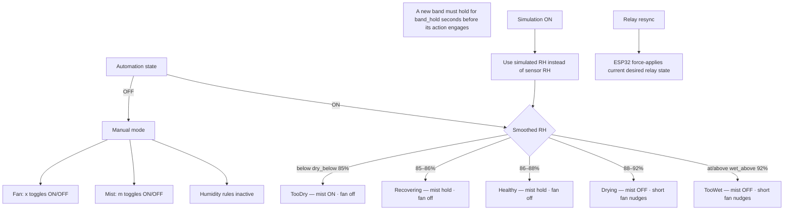

# monotub rules

This project controls a monotub with one humidity sensor, one fan relay, and one mist relay.

The control law is one linear model: classify the humidity into a **band**, then read
the mist and fan action straight off a single table. Airflow rises monotonically with
humidity; mist falls monotonically with it. There are no hidden timers or derived
thresholds — what you set is what runs.

## Quick Rule Chart

## Who Controls What

The ESP32 is the source of truth for the relays. The server and TUI only send commands
and display the latest ESP32 status.

**Automation ON (grow mode)** — one master switch for all logic:

- Mist and fan are both driven by the humidity band (table below).
- Manual `x` / `m` are disabled; use **Automation OFF** for service.

**Automation OFF (service mode)** — manual only:

- Fan: `x` toggles the relay.
- Mist: `m` toggles the relay.
- Humidity rules are inactive.

## The Band Table

This single table is the whole control law.

| Band       | RH range            | Mist | Fan         |
| ---------- | ------------------- | ---- | ----------- |
| TooDry     | below `dry_below`   | ON   | off         |
| Recovering | `dry_below`–`band_low`  | hold | off     |
| Healthy    | `band_low`–`band_high`  | hold | off     |
| Drying     | `band_high`–`wet_above` | OFF  | nudge   |
| TooWet     | at/above `wet_above`    | OFF  | nudge   |

Default band edges:

- `dry_below`: `85%`
- `band_low`: `86%`
- `band_high`: `88%`
- `wet_above`: `92%`

The four edges are explicit and independent — moving one does not shift the others.
They must stay ordered (`dry_below ≤ band_low ≤ band_high ≤ wet_above`); an out-of-order
change is rejected.

## Band Hold (the one debounce)

A newly entered band must hold continuously for `band_hold` seconds (default `10s`)
before its action engages. Until then the previous band's action stays in effect. This
is the only timing guard in the system — it replaces all the old persist timers,
cooldowns, and pulse caps. A brief humidity spike that clears before `band_hold` never
changes anything.

While a transition is pending, the TUI shows `settling Ns`.

## Mist Rules

Mist follows the table's mist column, which is deliberate hysteresis:

- Below `dry_below` (`85%`): mist ON.
- Above `band_high` (`88%`): mist OFF.
- In between (`85–88%`): mist holds its previous state.

That hold zone prevents the mist relay from flickering around one exact number. When
automation is OFF, `m` toggles mist manually and humidity does not control it.

## Fan Rules

The fan is a conservative wetness correction, not continuous FAE. Polyfill provides the
baseline air exchange; the fan only gives short nudges when humidity is above the healthy
band.

- **Off** (`TooDry`, `Recovering`, and `Healthy`, below `88%`): fan idle.
- **Nudge** (`Drying` and `TooWet`, at/above `88%`): short timed fan cycle.
  Default `5s` ON / `90s` OFF.

Once nudging starts, the ON phase stops by timer, not by waiting for RH to fall. The cycle
fully stops only after RH returns below `band_high` and that band passes `band_hold`.

## Automation OFF Rules

When automation is OFF:

- Humidity rules do not control fan or mist.
- Fan is manual with the `x` key.
- Mist is manual with the `m` key.
- Band edges and nudge settings are informational only.

## Simulation Rules

Simulation mode lets you test the rules without changing the real chamber humidity.

In the TUI Sensor section:

- `s` toggles simulation ON/OFF.
- `+` increases simulated humidity.
- `-` decreases simulated humidity.

When simulation is ON:

- The ESP32 uses the simulated humidity instead of the SHT31 humidity.
- The TUI shows `SIM`.
- Automation reacts exactly as if the real sensor had that humidity.

When simulation is OFF, the ESP32 goes back to using the real SHT31 sensor.

## Relay Sync Rules

On ESP32 boot:

- Relays are held OFF for `5s`.
- After the boot delay, the ESP32 force-applies the desired fan and mist relay states.

In the TUI Device section, `y` forces a relay resync — making the physical relay outputs
match the ESP32's current software state.

## TUI Key Rules

Fan section:

- `x` toggles manual fan only when automation is OFF.
No fan timing edits are exposed in the TUI; nudge timing is configured over MQTT / the
server API.

Mist section:

- `m` toggles manual mist only when automation is OFF.

Sensor section:

- `s` toggles simulation.
- `+` increases simulated humidity.
- `-` decreases simulated humidity.

Automation section:

- `a` toggles automation ON/OFF.

Device section:

- `y` resyncs relays.

Global:

- `Tab` changes section.
- `l` shows logs.
- `?` shows help.
- `q` quits.
