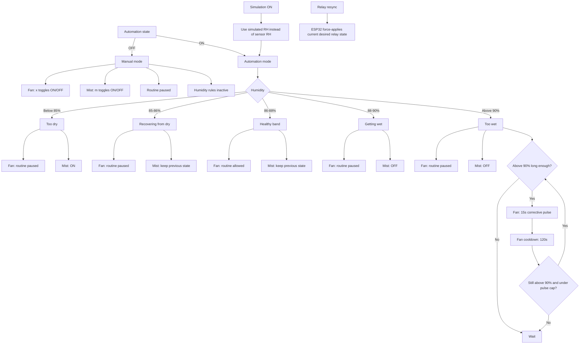

# monotub rules

This project controls a monotub with one humidity sensor, one fan relay, and one mist relay.

## Quick Rule Chart

## Who Controls What

The ESP32 is the source of truth for the relays. The server and TUI only send commands and display the latest ESP32 status.

**Automation ON (grow mode)** — one master switch for all logic:

- Mist: humidity rules (85–88% band).
- Fan: routine schedule in the healthy RH band, plus corrective pulses when too wet.
- Manual `x` / `m` are disabled; use **Automation OFF** for service.

**Automation OFF (service mode)** — manual only:

- Fan: `x` toggles the relay.
- Mist: `m` toggles the relay.
- Routine and humidity rules are paused (routine setting is saved for next grow mode).

## Humidity Bands

Default humidity targets:

- Hard low: `85%`
- Soft low: `86%`
- Soft high: `88%`
- Hard high: `90%`

Meaning:

- Below `85%`: too dry.
- `85-86%`: recovering from dry.
- `86-88%`: healthy working band.
- `88-90%`: getting wet, mist should stay off.
- Above `90%`: too wet.

## Mist Rules

When automation is ON:

- If humidity is below `85%`, mist turns ON.
- If humidity is above `88%`, mist turns OFF.
- Between `85%` and `88%`, mist keeps its previous state.

That middle zone is intentional. It prevents the mist relay from flickering on and off around one exact number.

When automation is OFF:

- The `m` key manually toggles mist ON/OFF.
- Humidity does not control mist.

When automation is ON, the `m` key is blocked because automation owns mist.

## Fan Routine Rules

The routine fan cycle is for normal fresh-air exchange.

Default routine:

- Fan ON for `30s`
- Fan OFF for `600s`

The routine only runs inside the soft humidity band:

- Routine allowed: `86-88%`
- Routine paused below `86%`
- Routine paused above `88%`
- Routine paused when automation is OFF

If the routine is paused, the TUI shows the pause reason:

- `humidity low`
- `humidity high`

When the routine resumes, it waits in the OFF phase before the next ON phase.

## High-Humidity Fan Correction

High-humidity correction is separate from the normal routine.

Default correction rules:

- If humidity stays above `90%`, run short corrective fan pulses.
- Default wait is up to `90s`; more severe humidity shortens the wait.
- Fan correction pulse length is `15s`.
- After a correction pulse, wait `120s` before another correction pulse can start.
- Corrective fan is capped at `6` pulses per hour.

So at `92%`, the fan does not run immediately. The system waits briefly to confirm humidity is truly high, runs a short pulse, settles, then repeats only if humidity stays too high.

## Automation OFF Rules

When automation is OFF:

- Humidity rules do not control fan or mist.
- Routine is paused.
- Fan is manual with the `x` key.
- Mist is manual.
- Humidity band and routine settings are informational only.

## Simulation Rules

Simulation mode lets you test the rules without changing the real chamber humidity.

In the TUI Sensor section:

- `s` toggles simulation ON/OFF.
- `+` increases simulated humidity.
- `-` decreases simulated humidity.

When simulation is ON:

- The ESP32 uses the simulated humidity instead of the SHT31 humidity.
- The TUI shows `SIM`.
- Automation reacts exactly as if the real sensor had that humidity.

When simulation is OFF:

- The ESP32 goes back to using the real SHT31 sensor.

## Relay Sync Rules

On ESP32 boot:

- Relays are held OFF for `5s`.
- After boot delay, the ESP32 force-applies the desired fan and mist relay states.

In the TUI Device section:

- `y` forces relay resync.

Relay resync is for making the physical relay outputs match the ESP32's current software state.

## TUI Key Rules

Fan section:

- `x` toggles manual fan only when automation is OFF.
- `r` toggles routine ON/OFF.
- `o` edits fan ON seconds.
- `f` edits fan OFF seconds.

Mist section:

- `m` toggles manual mist only when automation is OFF.

Sensor section:

- `s` toggles simulation.
- `+` increases simulated humidity.
- `-` decreases simulated humidity.

Automation section:

- `a` toggles automation ON/OFF.

Device section:

- `y` resyncs relays.

Global:

- `Tab` changes section.
- `l` shows logs.
- `?` shows help.
- `q` quits.
